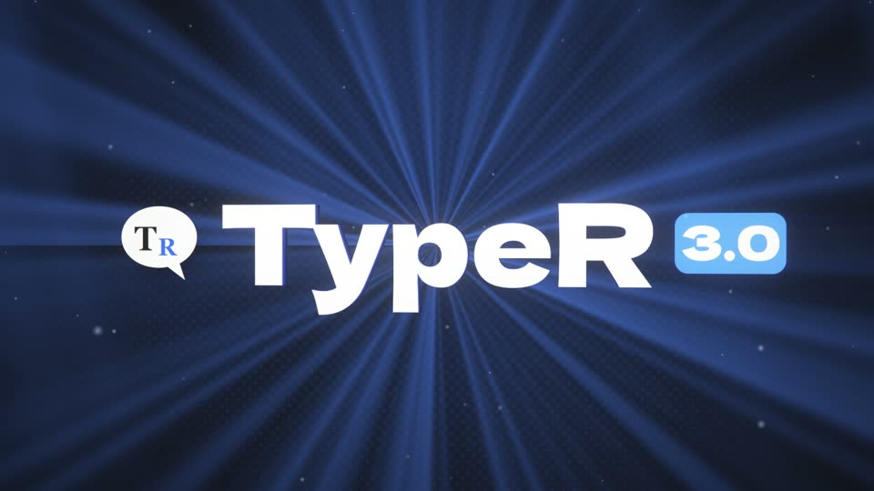
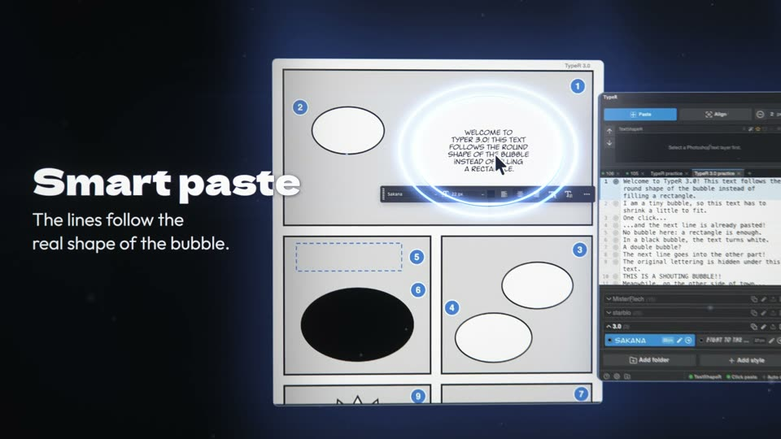
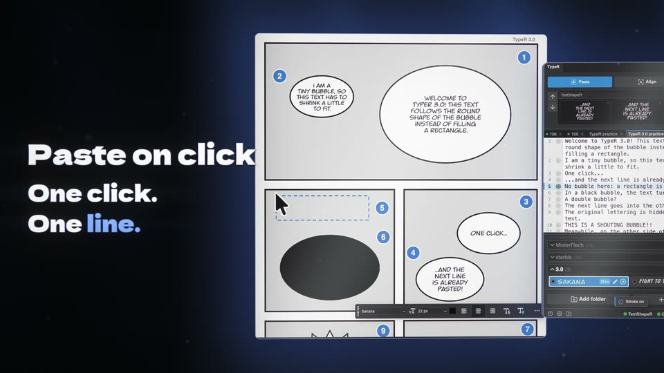
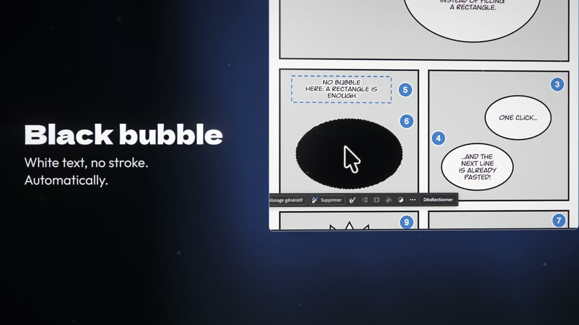
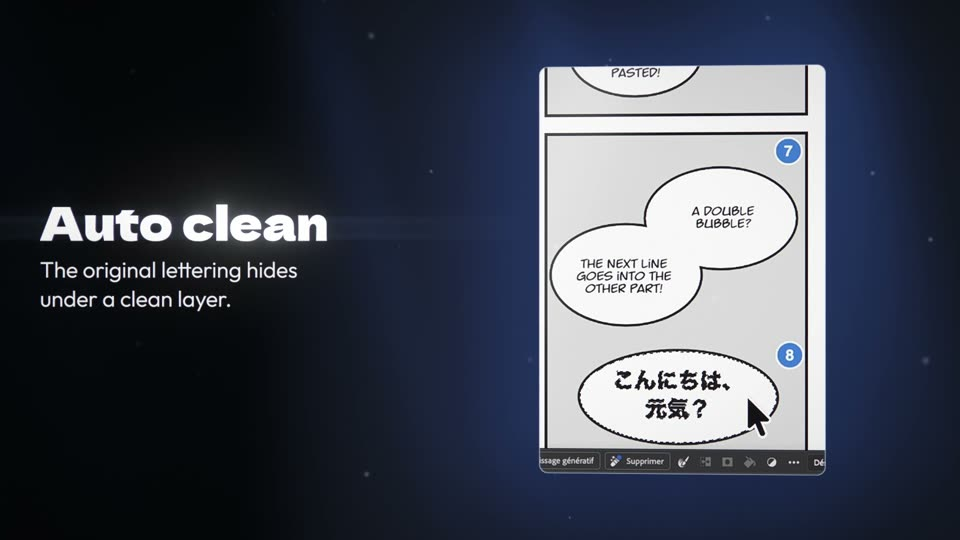
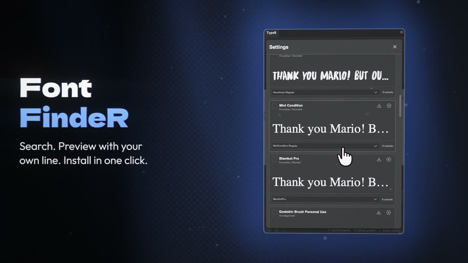
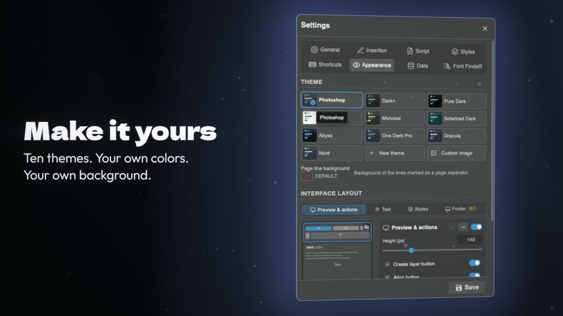

<p align="center">
  
</p>

<p align="center">
  <strong>Typeset manga and comics in one click, in Adobe Photoshop or in your browser.</strong>
</p>

<p align="center">
  Paste a script, click a bubble: the line lands in it with the right style, shaped to the bubble's real outline.<br>
  Then the next line is ready. Free, open source, and everything runs on your computer.
</p>

<p align="center">
  <a href="#quick-install"><strong>Install the new TypeR</strong></a>
  ·
  <a href="https://typer.hayasaku.fr/web">Web version</a>
  ·
  <a href="https://github.com/ScanR/TypeR/releases">Release notes</a>
  ·
  <a href="https://discord.com/invite/Pdmfmqk">Discord</a>
</p>

<p align="center">
  <a href="https://github.com/ScanR/TypeR/releases/latest"></a>
  <a href="https://github.com/ScanR/TypeR/releases"></a>
  
  
  <a href="./LICENSE.md"></a>
</p>

---

TypeR is a panel built for typesetters working on translated manga and comics. It keeps the script, the pages, the bubble selection, the text placement and your typography styles in one compact workspace, so the work comes down to one loop:

> **Click a bubble → the line is pasted, styled and fitted → the next line is ready.**

<table>
  <tr>
    <td width="50%"></td>
    <td width="50%"></td>
  </tr>
  <tr>
    <td></td>
    <td></td>
  </tr>
  <tr>
    <td></td>
    <td></td>
  </tr>
</table>

## Contents

- [What it does](#what-it-does)
- [Install](#install)
- [Your first page](#your-first-page)
- [Default shortcuts](#default-shortcuts)
- [Troubleshooting](#troubleshooting)
- [Build from source](#build-from-source)
- [Credits and license](#credits-and-license)

## What it does

### Smart paste

Paste reads the outline of the selected bubble instead of its bounding rectangle.

- The lines follow the bubble's silhouette and the ink is centered inside the outline, without the tail.
- The style's size is kept when the text fits. Otherwise it shrinks as little as possible, down to a minimum you set (75% by default), and one French or English hyphen is allowed as a last resort.
- Black bubbles get white text without a stroke.
- Double and triple bubbles receive the next script lines in their other chambers, in one history state.
- A style can be marked as the *Shout* or *Narration* style of its folder: spiky bubbles and narration boxes selected with the Magic Wand then use it. A script prefix always wins.
- **Auto clean** (optional) paints the bubble under the text on a `TypeR Clean` layer, on solid white or black only.
- **Conditional refont** gives the text between two markers another style's font.

When the text cannot be placed, the classic paste runs and a short notice explains why.

### Paste on click

Turn it on from the footer: a Magic Wand click, a rectangle or a lasso pastes the current line at once. Clicking again in a bubble that just got one line splits it, for the double bubbles TypeR did not detect. Undoing a TypeR paste in Photoshop puts the script line back.

### Your script, line by line

Paste your translated script into TypeR. Each usable line becomes a step of the queue. Empty lines and translator notes are skipped, and page headings connect the script to your files:

```text
Page 1
REG: This is regular dialogue.
SFX: BOOM!
## Translator note: keep the sign in the background.
```

`Page 12`, `Page 12 :`, `Page 12 : title`, `Page 12 - title`, `[Page 12]` and `## Page 12` are all recognized. Import `.psd`, `.png`, `.jpg` or `.jpeg` pages and TypeR opens the matching one as you advance. It can also save and close the previous PSD to keep long chapters manageable.

Work tabs keep separate series in one panel, name themselves after their PSD folder or chapter until you rename them, and can be reordered by dragging them. Saved work states restore a script, its pages, the current line and the active style. Bold and italic Markdown or rich text carry over to Photoshop.

### Styles that follow your script

Assign a prefix such as `REG:`, `THOUGHT:` or `SFX:` to a style. When a line matches, TypeR selects that style and removes the prefix from the text.

Create styles by hand or copy them from a Photoshop text layer. They cover the font and its face, size, leading, kerning, tracking, scale, alignment, baseline shift, anti-aliasing, synthetic bold and italic, underline, strikethrough, ligatures and contextual alternates, text color, stroke, and Arabic and Middle Eastern offsets. A style can also set lines made only of punctuation, like `?!`, at twice or three times the size.

Styles live in nested folders. Automatic matching stays in the folder of the active style, so a tag cannot jump to another project; you can change this in **Settings → Styles**, and turn matching off per style.

### Placement tools

- Replace the text and style of the selected text layers, or insert the text alone and keep the layer's style.
- Distribute consecutive lines across selected text layers, in selection order.
- Center selected layers in the selection, with configurable padding. Without a selection, TypeR can detect the bubble around the text. **Align** centers each text in its own chamber of a double or triple bubble.
- Capture several bubbles with multi-bubble mode, then create consecutive text layers in one action.
- Create point or paragraph text, globally or per style.
- Change the size of the active layer with the size buttons and your own increments.

### TextShapeR

TextShapeR proposes every good way to break the current line, ranked for the bubble from the active selection or the detected outline. The first proposal follows how letterers actually break lines, learned from about 3,000 hand-lettered bubbles. It detects the language and hyphenates by its rules. Preview, apply, apply and advance, undo, or chain it across several text layers. The inline panel is optional.

### FontScanR and Font FindeR

**FontScanR** scans finished `.psd` files and lists the font, usual size, color, stroke and anti-aliasing of their text layers, then turns the ones you pick into TypeR styles. It helps when joining an existing project or recovering a style guide.

**Font FindeR** searches a font catalogue, previews results with your own line and installs them in one click. FontScanR results and imported styles look up the fonts you are missing there.

### Share with your team

Export the folders, styles and fonts you choose, with an optional part of your settings, as JSON. A folder's export includes its subfolders. A `.zip` can also carry the matching `.ttf`, `.otf`, `.ttc` or `.otc` files, when the font licenses allow it. Fonts that cannot be found are reported instead of silently left out.

Project profiles keep styles, folders, settings, tabs, saved work and backgrounds separate. Manage them in **Settings → Data**.

### Make it yours

Themes, custom colors and background images, interface scale, a panel layout you can edit element by element, and a footer that adapts to narrow panels. The interface comes in English, French, German, Spanish, Brazilian Portuguese, Russian, Turkish, Ukrainian, Vietnamese and Arabic, with left-to-right and right-to-left text.

New here? A hands-on walkthrough and a What's new tour open from **Help** and **Settings → General**.

## Install

| | [Web version](https://typer.hayasaku.fr/web) | **New TypeR** (recommended) | Legacy |
| --- | --- | --- | --- |
| **You need** | A browser (Chrome or Edge work best) | Photoshop 2025 (26.0) or later | Photoshop CC 2015 (16.0) or later |
| **Built on** | TypeR's panel and paste engine in a Photoshop-like workspace | Adobe's UXP plugin framework | Adobe's older CEP extensions |
| **Apple Silicon** | Yes | Native | Through a Rosetta launcher on Photoshop 2026 |
| **Open it from** | [typer.hayasaku.fr/web](https://typer.hayasaku.fr/web) | **Plugins → TypeR → TypeR** | **Window → Extensions → TypeR** |

The new TypeR and Legacy are the same application: the new one is faster and runs natively on Apple Silicon. The [web version](https://typer.hayasaku.fr/web) opens and saves PSD files with nothing to install, and has no filters.

### Quick install

Close Photoshop, then paste one line.

On Windows, in **PowerShell**:

```powershell
irm https://raw.githubusercontent.com/ScanR/TypeR/master/get.ps1 | iex
```

On macOS, in **Terminal**:

```sh
curl -fsSL https://raw.githubusercontent.com/ScanR/TypeR/master/get.sh | bash
```

The installer finds your Photoshop and marks the version made for it as recommended. Choose with the arrow keys and press Enter. Creative Cloud is optional: without it, the plugin is installed directly and appears the next time Photoshop starts. With Creative Cloud, you can also just double-click [`TypeR-UXP.ccx`](https://github.com/ScanR/TypeR/releases/latest/download/TypeR-UXP.ccx).

### Coming from Legacy

Your styles, profiles and settings come with you: the new TypeR copies them on its first start and leaves the Legacy files untouched. An updated Legacy panel also offers the switch by itself when Photoshop can run the new TypeR, then shows up as **TypeR (old)**.

Both versions can stay installed, but do not open both panels at the same time: each shortcut would run twice.

### macOS: allow the shortcuts

Global shortcuts (such as `Cmd + Ctrl` for Paste) need to read the keyboard while the canvas has the focus. UXP cannot, so the plugin starts a small keyboard reader that reports the pressed keys while Photoshop is in front, and stops with Photoshop.

On macOS, add Photoshop to **System Settings → Privacy & Security → Input Monitoring**. Without it, macOS only shows the reader the modifiers and keys such as Enter, Tab or the function keys: shortcuts with a letter, digit or symbol do not run, and Photoshop shortcuts such as `Cmd + Shift + Z` also run the TypeR shortcut they start with.

### Updates

TypeR checks for updates when it starts and installs them from the panel, or by itself if you turn on **Settings → General → Install updates automatically**. Through Creative Cloud's installer, the new TypeR reloads without restarting Photoshop; otherwise, restart Photoshop afterwards. Your data is kept: the new TypeR stores it in `~/Library/Application Support/TypeR/UXP` on macOS and `%APPDATA%\TypeR\UXP` on Windows, outside Photoshop's version-specific folders.

<details>
<summary><strong>Install from the archive, offline</strong></summary>

1. [Download the latest `TypeR.zip`](https://github.com/ScanR/TypeR/releases/latest/download/TypeR.zip) and extract it completely.
2. Close Photoshop.
3. Run the installer and choose a version with the arrow keys and Enter:
   - Windows: double-click `install_win.cmd`.
   - macOS: double-click `install_mac.command`. macOS blocks it the first time, because the script is not signed by Apple: click **Done**, open **System Settings → Privacy & Security**, click **Open Anyway** at the bottom, then confirm. You can also run `bash install_mac.sh` from Terminal in the extracted folder.
4. Reopen Photoshop.

`-Uxp` / `-Legacy` on Windows and `--uxp` / `--legacy` on macOS skip the menu. `install_uxp_win.cmd` and `./install_uxp_mac.sh` install the new TypeR without asking.

</details>

<details>
<summary><strong>Legacy on Apple Silicon: Rosetta</strong></summary>

Photoshop 2026 (v27) and later only include CEP support in their Intel code, so the Legacy version appears only when Photoshop runs with Rosetta. Prefer the new TypeR, which runs natively.

For Legacy, recent macOS versions ignore Finder's **Open using Rosetta** option, so the installer creates a launcher in `~/Applications`, for example **Adobe Photoshop 2026 (TypeR)**. Put it in the Dock and use it instead of the usual Photoshop icon. TypeR is then under **Window → Extensions (Legacy) → TypeR**.

To repair an installation or recreate the launcher, close Photoshop and run from the extracted folder:

```sh
bash fix_mac_rosetta.sh
```

The script checks each installed Photoshop, installs Rosetta if needed, creates the launcher only for builds that require it, enables the CEP debug setting and removes the macOS download quarantine from TypeR files. If Photoshop is already open without Rosetta, the launcher offers to quit and reopen it.

</details>

<details>
<summary><strong>Update without opening TypeR</strong></summary>

Keep the standalone updater from the archive and run it whenever you want to check for a stable update:

- On Windows, double-click `update_typer_win.cmd`.
- On macOS, run `chmod +x update_typer_mac.sh` once, then `./update_typer_mac.sh`.

It downloads the latest `TypeR.zip`, validates the complete package before replacing files, preserves all `storage*` user data, and rolls back if installation fails. Reinstalling the same version can repair damaged files. Restart Photoshop afterwards.

</details>

<details>
<summary><strong>Compatibility details</strong></summary>

- Windows or macOS, with a standard desktop Photoshop. Portable or heavily modified builds may not load the panel.
- The new TypeR needs Photoshop 2025 (UXP 8.0), the first version whose plugin panels can display the plugin's own web pages, and is tested with Photoshop 2026.
- Legacy declares Photoshop 16.0+ and CEP 6+. It contains two builds of the same application: Photoshop 2020+ with Chromium 74+ loads the modern one, and older or unknown runtimes load the compatibility one automatically. It is an unsigned CEP extension: the installers place it in the user-level Adobe CEP extensions folder and set the required debug setting.

The project does not maintain a verified OS and version matrix, so compatibility is not guaranteed for every combination.

</details>

## Your first page

1. Open TypeR: **Plugins → TypeR → TypeR**, or **Window → Extensions → TypeR** for Legacy.
2. Paste your script into the text panel.
3. Optionally import the chapter pages and add `Page N` headings to the script.
4. Create a style or copy one from a Photoshop text layer, then assign its script prefix.
5. Select a bubble in Photoshop.
6. Click **Paste** or use the shortcut. Smart paste fits the text, and the next line is ready.
7. Use **Align** or TextShapeR if a bubble needs a hand.
8. Export your style folders once the project setup is ready to share.

## Default shortcuts

Every binding can be changed in **Settings → Shortcuts**, which warns when one combination is assigned twice. `Win` is TypeR's label for the operating-system key: Windows on Windows, Command on macOS. `Alt` is Option on macOS.

| Action | Default |
| --- | --- |
| Paste the current line in the selection and advance | `Win + Ctrl` |
| Apply the current line and style to the active layer | `Win + Shift` |
| Center the active layer in the selection | `Win + Alt` |
| Keep the active text size while pasting or applying | Hold `Alt` |
| Next / previous line | `Ctrl + Enter` / `Ctrl + Shift + Enter` |
| Next page | `Ctrl + Alt + Enter` |
| Increase / decrease text size | `Ctrl + Alt + U` / `Ctrl + Alt + D` |
| Insert text into the active layer without changing its style | `Ctrl + Alt + L` |
| Toggle multi-bubble mode | `Ctrl + Alt + M` |
| Show or hide cleaning layers | `Ctrl + H` |
| Select style 1 to 9 in the current folder (panel focused, outside a text field) | Numeric keypad `1` to `9` |

Available without a default key: paste on click, TextShapeR, previous page, previous or next style, next size preset, the style's stroke, apply style only, paste consecutive lines to selected layers, center a double bubble, cycle auto-center, remove or clear multi-bubble selections, previous or next tab.

A shortcut made of modifier keys only (`Win + Ctrl`, `Win + Shift`, `Win + Alt`) runs when you release it, and not if another key joined it: `Cmd + Shift + Z` stays Photoshop's redo. Behavior can vary with keyboard layouts and system bindings; if a combination conflicts with another application, assign a different one.

## Troubleshooting

<details>
<summary><strong>TypeR does not appear in Photoshop</strong></summary>

1. Close every Photoshop window and run the installer again. If you used the archive, extract it completely first.
2. Restart Photoshop and look under **Plugins → TypeR → TypeR**, or **Window → Extensions → TypeR** for Legacy.
3. Legacy on Apple Silicon: open Photoshop with the **Adobe Photoshop … (TypeR)** launcher in `~/Applications`, not the usual icon, and look under **Window → Extensions (Legacy)**. If the launcher is missing, close Photoshop and run `bash fix_mac_rosetta.sh`.
4. Check that you use a standard desktop Photoshop. Portable or light builds often remove or alter extension support.

</details>

<details>
<summary><strong>Shortcuts with a letter or digit do nothing on macOS</strong></summary>

Add Photoshop to **System Settings → Privacy & Security → Input Monitoring**. See [macOS: allow the shortcuts](#macos-allow-the-shortcuts).

</details>

<details>
<summary><strong>A shared style uses the wrong font</strong></summary>

The font must be installed on the receiving computer. An export can bundle the matching font files, when their license allows it, and Font FindeR can look up the missing ones.

</details>

<details>
<summary><strong>I want to update without losing my setup</strong></summary>

Installers and updates keep your data. For a portable copy, export your folders and settings to JSON first. An export covers one profile: to back up all of them on Legacy, close Photoshop and copy every `storage*` file and folder from the TypeR extension folder.

</details>

Still stuck? Ask on [Discord](https://discord.com/invite/Pdmfmqk) or [open an issue](https://github.com/ScanR/TypeR/issues/new) with your TypeR, Photoshop and OS versions, the steps that reproduce the problem, the expected and actual result, and a screenshot, recording or sanitized PSD when relevant.

## Build from source

You only need Node.js and npm to develop TypeR or install the unreleased branch. Use Node 24 (see `.nvmrc`); the minimum is Node 22.12.

```sh
git clone --branch develop https://github.com/ScanR/TypeR.git
cd TypeR
npm install
npm run build
```

Then install the extension with `install_win.cmd` on Windows or `./install_mac.sh` on macOS.

| Command | Purpose |
| --- | --- |
| `npm test` | Run the logic, locale and UXP test suites |
| `npm run build` | Create a production build |
| `npm run build_dev` | Create a development build |
| `npm run build_watch` | Rebuild while source files change |
| `npm run test:build` | Validate generated build artifacts |
| `npm run build:uxp` | Build the UXP plugin into `uxp/` |
| `npm run package:uxp` | Build the UXP plugin and package `Releases/TypeR-UXP.ccx` |
| `npm run test:uxp` | Run the UXP plugin's own test suites |
| `npm run verify` | Run the tests, a production build and the artifact checks |
| `npm run release` | Do all of the above and generate the release files |

[docs/uxp.md](docs/uxp.md) explains how the UXP plugin is put together and what to keep in step when `host.js` changes. [docs/smart-paste.md](docs/smart-paste.md) covers smart paste and paste on click.

### Contributing

Bug reports, translations, workflow suggestions and pull requests are welcome. Search the [existing issues](https://github.com/ScanR/TypeR/issues) first, keep changes focused, and run `npm run verify` before submitting a pull request.

### Preparing a release

`npm run release` generates `Releases/TypeR.zip` and `Releases/TypeR-UXP.ccx` with their SHA-256 checksums; `build_release.cmd` runs the same pipeline on Windows. Publish both, with their checksums: the UXP plugin looks for `TypeR-UXP.ccx` when it checks for updates. Publish this built ZIP rather than GitHub's source archive. See [the release acceptance checklist](docs/release-3.0.0.md) for the real-Photoshop checks and recovery procedures.

## Credits and license

TypeR is maintained by **Sakushi** and is based on [TyperTools](https://swirt.github.io/typertools/) by **Swirt**. Smart paste's bubble geometry and layout come from [MD TYPER](docs/smart-paste.md), a TypeR fork, reused with its author's permission.

Distributed under the [MIT License](./LICENSE.md). For help, join the [ScanR support server](https://discord.com/invite/Pdmfmqk).
